<h3><code>shaishta@github ~ $ ./contributions.sh</code></h3>

  

<h3><code>shaishta@github ~ $ whoami</code></h3>
<table>
  <tr>
    <td valign="top"></td>
    <td valign="top"></td>
  </tr>
</table>

 

<h3><code>shaishta@github ~ $ ls ~/projects</code></h3>

| Project | What it is | Stack | Links |
|:--|:--|:--|:--|
| **Finova** | AI money engine: auto-categorises 95%+ of transactions with Gemini | React · FastAPI · PostgreSQL · Redis · AWS | [live](https://ai-finance-yct4.vercel.app/) |
| **Campus Event Manager** | Event approvals and registration with role-based dashboards | Next.js · TypeScript · MongoDB · RBAC | [code](https://github.com/ShaishtaP/Event-Management-) · [live](https://event-management-ttdj.vercel.app/) |
| **Medusa on ECS Fargate** | Terraform IaC + GitHub Actions CD for a Medusa backend | Terraform · AWS ECS · Fargate · GitHub Actions | [code](https://github.com/ShaishtaP/IaC-Terraform-Medusa-AWS-ECS-Fargate-CD-GitHub-Actions) |
| **Strapi deploy automation** | Dockerised Strapi with automated build and deploy | Docker · GitHub Actions · AWS · Nginx | [code](https://github.com/ShaishtaP/strapi-deploy-automation) |

 

<h3><code>shaishta@github ~ $ cat contact.txt</code></h3>

[linkedin.com/in/shaishta-p-24shzf](https://www.linkedin.com/in/shaishta-p-24shzf/) &nbsp;·&nbsp; [shaishta.dev@gmail.com](mailto:shaishta.dev@gmail.com)

 

all art on this page is plain SVG generated by <a href="./scripts">./scripts</a> · the contribution graph refreshes daily via GitHub Actions

