<h3><code>shaishta@github ~ $ ./contributions.sh</code></h3>

  

<h3><code>shaishta@github ~ $ whoami</code></h3>
<table>
  <tr>
    <td valign="top"></td>
  </tr>
</table>

 

<h3><code>shaishta@github ~ $ gh stats</code></h3>
<table>
  <tr>
    <td valign="top"></td>
    <td valign="top"></td>
  </tr>
</table>

 

<h3><code>shaishta@github ~ $ ls ~/projects</code></h3>

| Project | What it is | Stack | Links |
|:--|:--|:--|:--|
| **AccessBridge** | Accessibility issue tracker: Playwright + axe-core audits, and a fix only counts once a fresh scan passes (95% recall on seeded defects) | React · Node.js · Express · MongoDB · Playwright · Docker | [code](https://github.com/ShaishtaP/accessbridge) · [live](https://accessbridge-app-sp.onrender.com) |
| **SkillSwap Ledger** | Time-credit marketplace on a double-entry ledger: 6 race conditions handled, zero double payouts, 78 tests | React · Node.js · Express · MongoDB · Socket.IO · WebRTC | [code](https://github.com/ShaishtaP/skillswap-ledger) · [live](https://skillswap-ledger.onrender.com/) |
| **Finova** | AI money engine: auto-categorises 95%+ of transactions with Gemini | React · FastAPI · PostgreSQL · Redis · AWS | [live](https://ai-finance-yct4.vercel.app/) |
| **Medusa on ECS Fargate** | Terraform IaC + GitHub Actions CD for a Medusa backend | Terraform · AWS ECS · Fargate · GitHub Actions | [code](https://github.com/ShaishtaP/IaC-Terraform-Medusa-AWS-ECS-Fargate-CD-GitHub-Actions) |
| **Strapi deploy automation** | Dockerised Strapi with automated build and deploy | Docker · GitHub Actions · AWS · Nginx | [code](https://github.com/ShaishtaP/strapi-deploy-automation) |

 

<h3><code>shaishta@github ~ $ cat contact.txt</code></h3>

[linkedin.com/in/shaishta-p-24shzf](https://www.linkedin.com/in/shaishta-p-24shzf/) &nbsp;·&nbsp; [shaishta.dev@gmail.com](mailto:shaishta.dev@gmail.com)

 

all art on this page is plain SVG generated by <a href="./scripts">./scripts</a> · the contribution graph refreshes daily via GitHub Actions

